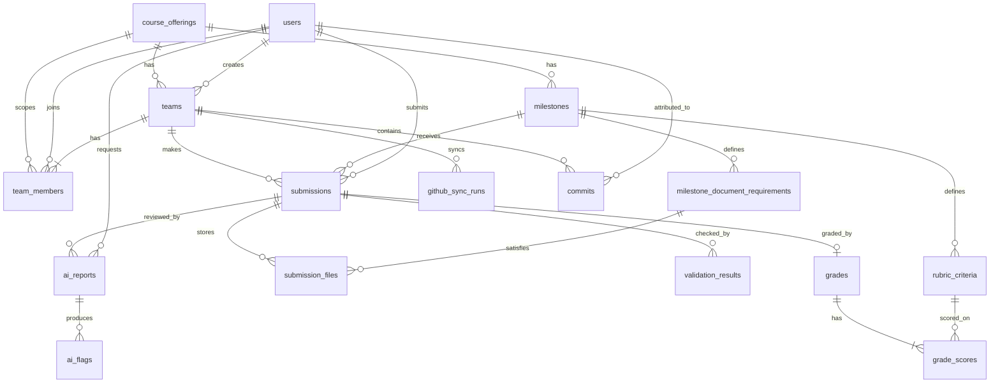

# 06 – Data Model

Database: PostgreSQL 15 on Supabase, accessed only through the `pg` driver from the backend (the Supabase client library is used only for file storage).

## 1. Entity relationship diagram

## 2. Conventions

- Primary keys are `uuid` with a generated default (`gen_random_uuid()`).
- Every table has `created_at` (timestamptz, not null, default now). Mutable tables also have `updated_at`, maintained automatically on every update.
- All timestamps are stored in UTC.
- Enumerations are `text` columns with a check constraint listing the allowed values (Section 4).
- Column names are `snake_case`; the API converts them to `camelCase`.
- Key legend used below: **PK** primary key, **FK** foreign key, **UQ** unique.
- The application never relies on cascades except where stated.

## 3. Tables

### 3.1 users

| Column          | Type        | Null | Key / default                        | Rules                                                                                                     |
| --------------- | ----------- | ---- | ------------------------------------ | --------------------------------------------------------------------------------------------------------- |
| id              | uuid        | No   | PK                                   |                                                                                                           |
| full_name       | text        | No   |                                      | 2–100 characters                                                                                          |
| student_id      | text        | Yes  | UQ (when not null)                   | Exactly 11 digits. Required when role is `student`                                                        |
| email           | text        | No   | UQ (case-insensitive)                | Valid format, at most 254 characters                                                                      |
| password_hash   | text        | No   |                                      | bcrypt hash, never returned by the API                                                                    |
| role            | text        | No   |                                      | `instructor` or `student`; never changes                                                                  |
| github_username | text        | Yes  | UQ (case-insensitive, when not null) | 1–39 characters, letters, digits and hyphens, not starting with a hyphen. Required when role is `student` |
| last_login_at   | timestamptz | Yes  |                                      |                                                                                                           |
| created_at      | timestamptz | No   | default now                          |                                                                                                           |
| updated_at      | timestamptz | No   | default now                          |                                                                                                           |

Table rule: a `student` row must have both `student_id` and `github_username`. An `instructor` row has neither. There is no active/inactive state for users.

### 3.2 course_offerings

| Column                | Type        | Null | Key / default                            | Rules                                                                                           |
| --------------------- | ----------- | ---- | ---------------------------------------- | ----------------------------------------------------------------------------------------------- |
| id                    | uuid        | No   | PK                                       |                                                                                                 |
| course_code           | text        | No   |                                          | Example `CSE4104`                                                                               |
| title                 | text        | No   |                                          |                                                                                                 |
| semester_label        | text        | No   |                                          | Example `Fall 2026`                                                                             |
| start_date            | date        | No   |                                          | Start of the first analysis period (00:00 Asia/Dhaka) and the earliest commit date a sync reads |
| end_date              | date        | No   |                                          | Must be after `start_date`                                                                      |
| allowed_sections      | text[]      | No   | default `{7A,7B,7C}`                     | At least one section                                                                            |
| team_name_pattern     | text        | No   | default `^CSE4104-[0-9][A-Z]-T[0-9]{2}$` | Must be a valid regular expression                                                              |
| registration_code     | text        | Yes  |                                          | When not empty, registration requires it (case-sensitive)                                       |
| min_team_size         | integer     | No   | default 2                                | At least 1                                                                                      |
| max_team_size         | integer     | No   | default 6                                | Between 1 and 10                                                                                |
| exclude_merge_commits | boolean     | No   | default true                             |                                                                                                 |
| exclude_bot_commits   | boolean     | No   | default true                             |                                                                                                 |
| is_active             | boolean     | No   | default true                             | Only one offering can be active                                                                 |
| created_at            | timestamptz | No   | default now                              |                                                                                                 |
| updated_at            | timestamptz | No   | default now                              |                                                                                                 |

Table rules: `end_date > start_date`; `1 <= min_team_size <= max_team_size`; at most one row with `is_active = true` (unique partial index).

### 3.3 teams

| Column             | Type        | Null | Key / default            | Rules                                                                                     |
| ------------------ | ----------- | ---- | ------------------------ | ----------------------------------------------------------------------------------------- |
| id                 | uuid        | No   | PK                       |                                                                                           |
| course_offering_id | uuid        | No   | FK → course_offerings.id |                                                                                           |
| name               | text        | No   |                          | Generated: `{course_code}-{section}-T{NN}`, must match the offering's name pattern        |
| section            | text        | No   |                          | One of the offering's allowed sections                                                    |
| team_number        | integer     | No   |                          | 1–99, assigned by the server (see below)                                                  |
| project_title      | text        | No   |                          | 3–150 characters                                                                          |
| repository_url     | text        | No   |                          | Canonical form `https://github.com/{repo_owner}/{repo_name}`, verified public at creation |
| repo_owner         | text        | No   |                          | As returned by GitHub                                                                     |
| repo_name          | text        | No   |                          | As returned by GitHub                                                                     |
| created_by         | uuid        | No   | FK → users.id            | The student who created the team                                                          |
| created_at         | timestamptz | No   | default now              |                                                                                           |
| updated_at         | timestamptz | No   | default now              |                                                                                           |

Team number assignment: team creation runs in one transaction. It locks the course offering row (`SELECT id FROM course_offerings WHERE id = $1 FOR UPDATE`), reads `COALESCE(MAX(team_number), 0)` for the offering and section, adds 1, and uses the result. If the maximum is already 99, creation fails with `TEAM_LIMIT_REACHED`. Teams are never deleted, so a number is never reused.

Unique constraints: (`course_offering_id`, `name`); (`course_offering_id`, `section`, `team_number`); unique index on (`course_offering_id`, `lower(repo_owner)`, `lower(repo_name)`) so one repository belongs to one team per offering.

Immutable columns: `name`, `section`, `team_number`, `repository_url`, `repo_owner` and `repo_name` are never updated after creation, by anyone. Only `project_title` can be edited (by the Team Leader). There is no active/inactive state for teams.

### 3.4 team_members

| Column             | Type        | Null | Key / default                     | Rules                                                                  |
| ------------------ | ----------- | ---- | --------------------------------- | ---------------------------------------------------------------------- |
| id                 | uuid        | No   | PK                                |                                                                        |
| team_id            | uuid        | No   | FK → teams.id (on delete cascade) |                                                                        |
| user_id            | uuid        | No   | FK → users.id                     | Must be a student                                                      |
| course_offering_id | uuid        | No   | FK → course_offerings.id          | Copy of the team's offering, used for the "one team per offering" rule |
| project_role       | text        | No   |                                   | 2–60 characters; the leader has `Team Leader`                          |
| is_leader          | boolean     | No   | default false                     |                                                                        |
| created_at         | timestamptz | No   | default now                       |                                                                        |

Unique constraints: (`team_id`, `user_id`); (`course_offering_id`, `user_id`), so a student belongs to at most one team per offering. A unique partial index on `team_id` where `is_leader = true` guarantees at most one leader per team. Index on `user_id`.

Leader transfer runs in one transaction: first set the old leader's `is_leader` to false, then set the new leader's to true, so that exactly one leader exists after commit. The old leader's project role is not changed automatically.

### 3.5 milestones

| Column             | Type         | Null | Key / default            | Rules                     |
| ------------------ | ------------ | ---- | ------------------------ | ------------------------- |
| id                 | uuid         | No   | PK                       |                           |
| course_offering_id | uuid         | No   | FK → course_offerings.id |                           |
| week_number        | integer      | No   |                          | 1–14                      |
| title              | text         | No   |                          | 3–150 characters          |
| description        | text         | No   | default empty            | At most 5,000 characters  |
| guidelines         | text         | No   | default empty            | At most 10,000 characters |
| deadline           | timestamptz  | No   |                          |                           |
| max_marks          | numeric(6,2) | No   |                          | Greater than 0            |
| require_live_url   | boolean      | No   | default false            |                           |
| status             | text         | No   | default `draft`          | `draft` or `published`    |
| published_at       | timestamptz  | Yes  |                          | Set when published        |
| created_by         | uuid         | No   | FK → users.id            | An Instructor             |
| created_at         | timestamptz  | No   | default now              |                           |
| updated_at         | timestamptz  | No   | default now              |                           |

Unique constraint: (`course_offering_id`, `week_number`). The deadline-order rule across published milestones is checked by the application.

### 3.6 milestone_document_requirements

| Column           | Type        | Null | Key / default                          | Rules                                                                                                                                   |
| ---------------- | ----------- | ---- | -------------------------------------- | --------------------------------------------------------------------------------------------------------------------------------------- |
| id               | uuid        | No   | PK                                     |                                                                                                                                         |
| milestone_id     | uuid        | No   | FK → milestones.id (on delete cascade) |                                                                                                                                         |
| key              | text        | No   |                                        | Lowercase letter first, then lowercase letters, digits or underscore, 2–30 characters                                                   |
| label            | text        | No   |                                        | 2–80 characters                                                                                                                         |
| filename_pattern | text        | No   |                                        | 3–120 characters of letters, digits, `_`, `{`, `}`, `.`, `-`. Only the placeholder `{TEAM}` is allowed. Must end with `.pdf` or `.docx` |
| is_required      | boolean     | No   | default true                           |                                                                                                                                         |
| sort_order       | integer     | No   | default 0                              |                                                                                                                                         |
| created_at       | timestamptz | No   | default now                            |                                                                                                                                         |

Unique constraint: (`milestone_id`, `key`). The list is replaced as a whole. The allowed file type of a requirement is the extension of its pattern.

### 3.7 rubric_criteria

| Column       | Type         | Null | Key / default                          | Rules                    |
| ------------ | ------------ | ---- | -------------------------------------- | ------------------------ |
| id           | uuid         | No   | PK                                     |                          |
| milestone_id | uuid         | No   | FK → milestones.id (on delete cascade) |                          |
| title        | text         | No   |                                        | 2–100 characters         |
| description  | text         | No   | default empty                          | At most 1,000 characters |
| max_points   | numeric(6,2) | No   |                                        | Greater than 0           |
| sort_order   | integer      | No   | default 0                              |                          |
| created_at   | timestamptz  | No   | default now                            |                          |

Index on (`milestone_id`, `sort_order`). The list is replaced as a whole. The sum of `max_points` must equal the milestone's `max_marks` before it can be published.

### 3.8 submissions

One row per team and milestone. A row exists only after every validation and file check passed; a rejected attempt stores nothing. A submission is never edited or replaced.

| Column       | Type        | Null | Key / default      | Rules                                                                                                                |
| ------------ | ----------- | ---- | ------------------ | -------------------------------------------------------------------------------------------------------------------- |
| id           | uuid        | No   | PK                 |                                                                                                                      |
| team_id      | uuid        | No   | FK → teams.id      |                                                                                                                      |
| milestone_id | uuid        | No   | FK → milestones.id |                                                                                                                      |
| status       | text        | No   | default `checked`  | `checked`, `ai_reviewed`, `graded`, `published` (Section 6). Students see a reduced value, see the API specification |
| live_url     | text        | Yes  |                    | Null if the milestone does not require it                                                                            |
| notes        | text        | Yes  |                    | At most 2,000 characters                                                                                             |
| submitted_by | uuid        | No   | FK → users.id      | The Team Leader                                                                                                      |
| submitted_at | timestamptz | No   |                    | The server's `receivedAt`, taken at the start of the request                                                         |
| is_late      | boolean     | No   | default false      | Set once at creation by comparing `submitted_at` with the deadline; never changes                                    |
| created_at   | timestamptz | No   | default now        |                                                                                                                      |
| updated_at   | timestamptz | No   | default now        |                                                                                                                      |

Unique constraint: (`team_id`, `milestone_id`). A violation of it (SQLSTATE `23505`) is reported as `SUBMISSION_EXISTS`. Index on `milestone_id`. Only `status` changes after creation. The repository is always the team's repository.

### 3.9 submission_files

| Column            | Type        | Null | Key / default                           | Rules                                                                    |
| ----------------- | ----------- | ---- | --------------------------------------- | ------------------------------------------------------------------------ |
| id                | uuid        | No   | PK                                      |                                                                          |
| submission_id     | uuid        | No   | FK → submissions.id (on delete cascade) |                                                                          |
| requirement_id    | uuid        | No   | FK → milestone_document_requirements.id |                                                                          |
| original_filename | text        | No   |                                         |                                                                          |
| storage_path      | text        | No   |                                         | Private bucket path, never returned by the API                           |
| size_bytes        | integer     | No   |                                         | 1 to 10,485,760                                                          |
| mime_type         | text        | No   |                                         | Detected from the file bytes; `application/pdf` or the `.docx` Word type |
| sha256            | text        | No   |                                         |                                                                          |
| created_at        | timestamptz | No   | default now                             |                                                                          |

Unique constraint: (`submission_id`, `requirement_id`), one file per requirement.

### 3.10 validation_results

One row per check of a stored submission. Because a submission is stored only after every check passed, these rows record the passing report (a check that did not apply is `skipped`). The full per-check report of a rejected attempt or a dry-run is returned in the response and is not stored.

| Column        | Type        | Null | Key / default                           | Rules                                                                                                  |
| ------------- | ----------- | ---- | --------------------------------------- | ------------------------------------------------------------------------------------------------------ |
| id            | uuid        | No   | PK                                      |                                                                                                        |
| submission_id | uuid        | No   | FK → submissions.id (on delete cascade) |                                                                                                        |
| check_type    | text        | No   |                                         | See Section 4                                                                                          |
| status        | text        | No   |                                         | `passed`, `failed`, `skipped`, `error`                                                                 |
| message       | text        | No   |                                         |                                                                                                        |
| details       | jsonb       | No   | default `{}`                            | For example final status, redirect count and response time for the Phase 2 live URL reachability check |
| checked_at    | timestamptz | No   | default now                             |                                                                                                        |

Unique constraint: (`submission_id`, `check_type`).

### 3.11 github_sync_runs

| Column         | Type        | Null | Key / default                     | Rules                                                                     |
| -------------- | ----------- | ---- | --------------------------------- | ------------------------------------------------------------------------- |
| id             | uuid        | No   | PK                                |                                                                           |
| team_id        | uuid        | No   | FK → teams.id (on delete cascade) |                                                                           |
| triggered_by   | uuid        | Yes  | FK → users.id                     | Null for a submission-triggered sync                                      |
| trigger        | text        | No   |                                   | `submission` or `manual`                                                  |
| status         | text        | No   | default `queued`                  | `queued`, `running`, `completed`, `failed`                                |
| repo_full_name | text        | No   |                                   | `owner/name`                                                              |
| started_at     | timestamptz | Yes  |                                   |                                                                           |
| finished_at    | timestamptz | Yes  |                                   |                                                                           |
| commits_found  | integer     | No   | default 0                         |                                                                           |
| commits_new    | integer     | No   | default 0                         |                                                                           |
| truncated      | boolean     | No   | default false                     | True when more than 2,000 commits exist                                   |
| error_code     | text        | Yes  |                                   | For example `GITHUB_REPO_NOT_FOUND`, `GITHUB_RATE_LIMITED`, `INTERRUPTED` |
| error_message  | text        | Yes  |                                   |                                                                           |
| created_at     | timestamptz | No   | default now                       |                                                                           |

Index on (`team_id`, `created_at` descending). A unique partial index on `team_id` where `status` is `queued` or `running` guarantees one active sync per team.

### 3.12 commits

| Column         | Type        | Null | Key / default                      | Rules                                             |
| -------------- | ----------- | ---- | ---------------------------------- | ------------------------------------------------- |
| id             | uuid        | No   | PK                                 |                                                   |
| team_id        | uuid        | No   | FK → teams.id (on delete cascade)  |                                                   |
| repo_full_name | text        | No   |                                    |                                                   |
| sha            | text        | No   |                                    | 40 lowercase hexadecimal characters               |
| author_login   | text        | Yes  |                                    | GitHub login, may be null                         |
| author_name    | text        | No   | default empty                      |                                                   |
| author_email   | text        | No   | default empty                      |                                                   |
| authored_at    | timestamptz | No   |                                    |                                                   |
| committed_at   | timestamptz | No   |                                    |                                                   |
| message        | text        | No   | default empty                      | At most 4,000 characters                          |
| additions      | integer     | No   | default 0                          | 0 or more                                         |
| deletions      | integer     | No   | default 0                          | 0 or more                                         |
| files_changed  | integer     | No   | default 0                          | 0 or more                                         |
| is_merge       | boolean     | No   | default false                      | More than one parent                              |
| is_bot         | boolean     | No   | default false                      | Login ends with `[bot]` or GitHub user type `Bot` |
| member_user_id | uuid        | Yes  | FK → users.id (on delete set null) | Null means "Unassigned"                           |
| branches       | text[]      | No   | default empty                      |                                                   |
| html_url       | text        | No   |                                    | Link to the commit on GitHub                      |
| fetched_at     | timestamptz | No   | default now                        |                                                   |

Unique constraint: (`team_id`, `repo_full_name`, `sha`). Indexes: (`team_id`, `authored_at`) and (`team_id`, `member_user_id`).

### 3.13 ai_reports

Each review request creates a new row; earlier reports are kept.

| Column           | Type        | Null | Key / default                           | Rules                                                                                              |
| ---------------- | ----------- | ---- | --------------------------------------- | -------------------------------------------------------------------------------------------------- |
| id               | uuid        | No   | PK                                      |                                                                                                    |
| submission_id    | uuid        | No   | FK → submissions.id (on delete cascade) |                                                                                                    |
| requested_by     | uuid        | No   | FK → users.id                           | An Instructor                                                                                      |
| status           | text        | No   | default `pending`                       | `pending`, `completed`, `failed`                                                                   |
| model            | text        | No   |                                         |                                                                                                    |
| prompt_version   | text        | No   |                                         | Fixed in code, for example `v1.0`                                                                  |
| input_hash       | text        | Yes  |                                         | SHA-256 of the exact request body                                                                  |
| period_start     | timestamptz | No   |                                         | Analysis period start                                                                              |
| period_end       | timestamptz | No   |                                         | Analysis period end                                                                                |
| label_map        | jsonb       | No   | default `{}`                            | Maps labels (`Member A`, `Unassigned Author 1`, …) to a user ID or `null`; never to names          |
| metrics_snapshot | jsonb       | Yes  |                                         | Metrics sent to the AI                                                                             |
| result           | jsonb       | Yes  |                                         | Validated output without the flags: `summary`, `memberSummaries` (by label) and `droppedFlagCount` |
| tokens_input     | integer     | Yes  |                                         |                                                                                                    |
| tokens_output    | integer     | Yes  |                                         |                                                                                                    |
| error_code       | text        | Yes  |                                         | For example `AI_UNAVAILABLE`, `AI_INVALID_OUTPUT`, `INTERRUPTED`                                   |
| error_message    | text        | Yes  |                                         |                                                                                                    |
| dismissed_at     | timestamptz | Yes  |                                         | Set when an Instructor dismisses the report                                                        |
| dismissed_by     | uuid        | Yes  | FK → users.id                           |                                                                                                    |
| created_at       | timestamptz | No   | default now                             |                                                                                                    |
| completed_at     | timestamptz | Yes  |                                         |                                                                                                    |

Indexes: (`submission_id`, `created_at` descending) and (`requested_by`, `created_at`), the second one for counting an Instructor's requests in the last hour. A unique partial index on `submission_id` where `status = 'pending'` allows only one pending review per submission.

### 3.14 ai_flags

Flags produced by the AI for one report. Only flags that cite at least one existing commit are stored; the others are dropped and counted in the report's `result`.

| Column               | Type        | Null | Key / default                          | Rules                                               |
| -------------------- | ----------- | ---- | -------------------------------------- | --------------------------------------------------- |
| id                   | uuid        | No   | PK                                     |                                                     |
| ai_report_id         | uuid        | No   | FK → ai_reports.id (on delete cascade) |                                                     |
| flag_type            | text        | No   |                                        | See Section 4                                       |
| severity             | text        | No   |                                        | `low`, `medium`, `high`                             |
| member_user_id       | uuid        | Yes  | FK → users.id (on delete set null)     | The member the flag is about, if any                |
| title                | text        | No   |                                        |                                                     |
| description          | text        | No   |                                        |                                                     |
| evidence_commit_shas | text[]      | No   |                                        | At least one SHA (mapped back from the commit refs) |
| created_at           | timestamptz | No   | default now                            |                                                     |

Index on `ai_report_id`.

### 3.15 grades

At most one grade per submission.

| Column        | Type         | Null | Key / default                               | Rules                            |
| ------------- | ------------ | ---- | ------------------------------------------- | -------------------------------- |
| id            | uuid         | No   | PK                                          |                                  |
| submission_id | uuid         | No   | FK → submissions.id (on delete cascade), UQ |                                  |
| status        | text         | No   | default `draft`                             | `draft`, `approved`, `published` |
| total_score   | numeric(6,2) | Yes  |                                             | Sum of the criterion scores      |
| feedback      | text         | No   | default empty                               | At most 5,000 characters         |
| approved_by   | uuid         | Yes  | FK → users.id                               |                                  |
| approved_at   | timestamptz  | Yes  |                                             |                                  |
| published_by  | uuid         | Yes  | FK → users.id                               |                                  |
| published_at  | timestamptz  | Yes  |                                             |                                  |
| created_by    | uuid         | No   | FK → users.id                               | An Instructor                    |
| updated_by    | uuid         | No   | FK → users.id                               | An Instructor                    |
| created_at    | timestamptz  | No   | default now                                 |                                  |
| updated_at    | timestamptz  | No   | default now                                 |                                  |

### 3.16 grade_scores

| Column       | Type         | Null | Key / default                      | Rules                                                                                                               |
| ------------ | ------------ | ---- | ---------------------------------- | ------------------------------------------------------------------------------------------------------------------- |
| id           | uuid         | No   | PK                                 |                                                                                                                     |
| grade_id     | uuid         | No   | FK → grades.id (on delete cascade) |                                                                                                                     |
| criterion_id | uuid         | No   | FK → rubric_criteria.id            |                                                                                                                     |
| score        | numeric(6,2) | Yes  |                                    | 0 or more, at most the criterion's `max_points`, at most 2 decimals (the upper bound is checked by the application) |
| comment      | text         | No   | default empty                      | At most 1,000 characters; at least 10 characters to approve                                                         |

Unique constraint: (`grade_id`, `criterion_id`).

## 4. Enumerations (single source of truth)

| Column                                                                 | Allowed values                                                                                                       |
| ---------------------------------------------------------------------- | -------------------------------------------------------------------------------------------------------------------- |
| `users.role`                                                           | `instructor`, `student`                                                                                              |
| `milestones.status`                                                    | `draft`, `published`                                                                                                 |
| `submissions.status` (stored, shown to Instructors)                    | `checked`, `ai_reviewed`, `graded`, `published`                                                                      |
| Student status (API only, shown to students and leaders, never stored) | `submitted`, `published`                                                                                             |
| `validation_results.check_type`                                        | `required_fields`, `team_name_format`, `file_names`, `file_types`, `file_sizes`, `repository_accessible`, `live_url` |
| `validation_results.status`                                            | `passed`, `failed`, `skipped`, `error`                                                                               |
| `github_sync_runs.trigger`                                             | `submission`, `manual`                                                                                               |
| `github_sync_runs.status`                                              | `queued`, `running`, `completed`, `failed`                                                                           |
| `ai_reports.status`                                                    | `pending`, `completed`, `failed`                                                                                     |
| `ai_flags.flag_type`                                                   | `low_information_commit_messages`, `off_topic_commits`, `repetitive_trivial_commits`                                 |
| `ai_flags.severity`                                                    | `low`, `medium`, `high`                                                                                              |
| `grades.status`                                                        | `draft`, `approved`, `published`                                                                                     |

The dashboard additionally uses the **derived** value `not_submitted` for a team with no submission; it is never stored.

## 5. Relationships

| Parent table                    | Child table                     | Cardinality | Foreign key in child                              | On delete |
| ------------------------------- | ------------------------------- | ----------- | ------------------------------------------------- | --------- |
| course_offerings                | teams                           | 1 : many    | course_offering_id                                | Restrict  |
| course_offerings                | team_members                    | 1 : many    | course_offering_id                                | Restrict  |
| course_offerings                | milestones                      | 1 : many    | course_offering_id                                | Restrict  |
| users                           | teams                           | 1 : many    | created_by                                        | Restrict  |
| users                           | team_members                    | 1 : many    | user_id                                           | Restrict  |
| teams                           | team_members                    | 1 : 1..many | team_id                                           | Cascade   |
| teams                           | submissions                     | 1 : many    | team_id                                           | Restrict  |
| milestones                      | submissions                     | 1 : many    | milestone_id                                      | Restrict  |
| milestones                      | milestone_document_requirements | 1 : many    | milestone_id                                      | Cascade   |
| milestones                      | rubric_criteria                 | 1 : many    | milestone_id                                      | Cascade   |
| users                           | submissions                     | 1 : many    | submitted_by                                      | Restrict  |
| submissions                     | submission_files                | 1 : many    | submission_id                                     | Cascade   |
| milestone_document_requirements | submission_files                | 1 : many    | requirement_id                                    | Restrict  |
| submissions                     | validation_results              | 1 : many    | submission_id                                     | Cascade   |
| teams                           | github_sync_runs                | 1 : many    | team_id                                           | Cascade   |
| users                           | github_sync_runs                | 1 : many    | triggered_by                                      | Restrict  |
| teams                           | commits                         | 1 : many    | team_id                                           | Cascade   |
| users                           | commits                         | 1 : many    | member_user_id                                    | Set null  |
| submissions                     | ai_reports                      | 1 : many    | submission_id                                     | Cascade   |
| users                           | ai_reports                      | 1 : many    | requested_by, dismissed_by                        | Restrict  |
| ai_reports                      | ai_flags                        | 1 : many    | ai_report_id                                      | Cascade   |
| users                           | ai_flags                        | 1 : many    | member_user_id                                    | Set null  |
| submissions                     | grades                          | 1 : 0..1    | submission_id                                     | Cascade   |
| users                           | grades                          | 1 : many    | created_by, updated_by, approved_by, published_by | Restrict  |
| grades                          | grade_scores                    | 1 : 1..many | grade_id                                          | Cascade   |
| rubric_criteria                 | grade_scores                    | 1 : many    | criterion_id                                      | Restrict  |

## 6. Derived submission status

The stored status is computed by one function, `recomputeSubmissionStatus(submissionId)`, and nowhere else. It is called after: submission creation, AI report completion, failure or dismissal, and grade approve, publish, unpublish or edit.

1. Load the submission and its grade (the grade may not exist).
2. If a grade exists and its status is `published` → `published`.
3. Otherwise, if a grade exists and its status is `approved` → `graded`.
4. Otherwise, if the submission has an AI report with status `completed` and `dismissed_at` empty → `ai_reviewed`.
5. Otherwise → `checked`.
6. Save the result in `submissions.status`.

A new submission always starts as `checked`, because it is stored only after validation passed. The late flag is not recomputed; it is set once at creation.

The **student status** is computed when a response is built for a student or Team Leader: `published` stays `published`; `checked`, `ai_reviewed` and `graded` all become `submitted`. It is never stored.

## 7. Seed data

The seed script is idempotent (running it twice changes nothing) and does exactly this:

1. If no course offering exists, insert one: `course_code = 'CSE4104'`, `title = 'Software Development III'`, `semester_label = 'Fall 2026'`, `start_date = '2026-09-01'`, `end_date = '2027-01-31'`, `is_active = true`, and the column defaults for everything else (including team sizes 2 and 6).
2. If no user with the configured instructor email exists, insert an Instructor with the configured name, that email and the bcrypt hash of the configured password.

A development-only demo seed (refuses to run in production) adds 8 demo students, 2 teams, 2 milestones with rubrics and fixture commits for UI development and for the demo.

## 8. Integrity and deletion rules

- Teams are created in one transaction that locks the offering row, assigns the team number (Section 3.3), creates the team and creates the leader's membership. The GitHub check happens before the transaction.
- A submission is created in two stages. First the files are uploaded to private storage. Then one transaction inserts the submission, its file rows and its validation results. If the transaction fails, the uploaded objects are deleted from storage. No transaction stays open during an upload.
- Deleting a milestone is allowed only if it is a draft or has no submissions; it cascades to its document requirements and rubric criteria.
- Users are never deleted by the application. Teams are never deleted or deactivated; the repository URL, team name and team number never change.
- Submissions are never updated except for `status`, and never deleted except by the purge script.
- Data of a whole course offering, including storage objects, is removed only by the Instructor's purge script.
- A commit keeps `member_user_id` only while that user is a member of the team. When a member is added or removed, or a member's GitHub username changes, attribution is recomputed from the stored commits without calling GitHub.
- No table stores risk flags, risk thresholds, submission versions, audit logs or notifications.