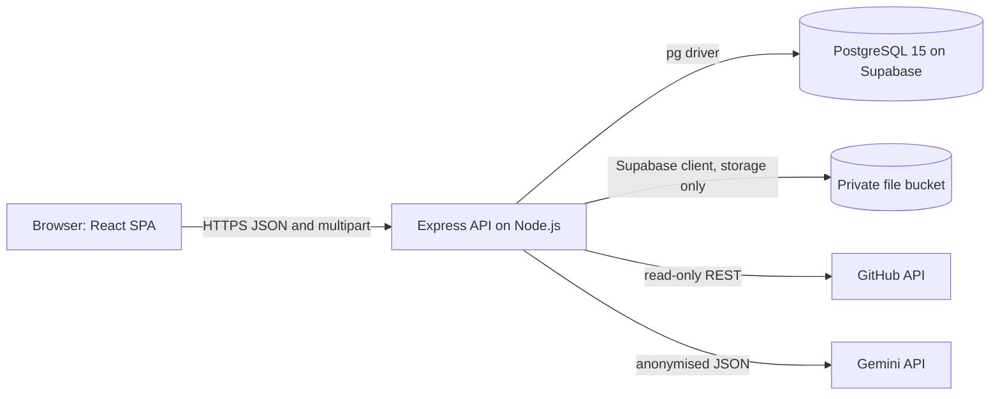

# 08 – Architecture and Project Structure

## 1. System overview

CourseLens is a single-page web application with a REST backend. The browser talks only to the backend. The backend talks to the database, to file storage, to the GitHub REST API and to the Google Gemini API.



Key decisions:

- **Exactly one backend process.** Background work (GitHub sync, AI review) runs **inside the same process**; its state is stored in the database and the browser polls every 3 seconds. Because there is only one process, any unfinished job found at server start is orphaned (see Section 7.6). Never run two backend instances against the same database.
- The database is used only through the `pg` driver. The Supabase client library is used only for file storage.
- Secrets (database URL, JWT secret, GitHub token, Gemini key, storage key) exist only in the backend environment.
- The frontend never calls GitHub, Gemini or storage directly.

## 2. Technology stack

| Area          | Choice                                                                       |
| ------------- | ---------------------------------------------------------------------------- |
| Runtime       | Node.js 22 LTS                                                               |
| Backend       | Express 4 (JavaScript, ES modules)                                           |
| Database      | PostgreSQL 15 (Supabase), `pg` driver, plain `.sql` migrations               |
| File storage  | Supabase Storage, one private bucket (`@supabase/supabase-js`)               |
| Validation    | `zod`                                                                        |
| Auth          | `jsonwebtoken` (HS256), `bcryptjs` (cost 10)                                 |
| Security      | `helmet`, `cors`                                                             |
| Uploads       | `multer` (memory storage, 10 MB per file), `file-type` for real content type |
| AI            | Google Gemini through its REST API with `fetch`                              |
| GitHub        | GitHub REST API through `fetch`, read-only token                             |
| Frontend      | React 18, Vite 5, React Router 6                                             |
| Charts        | Recharts                                                                     |
| Styling       | Tailwind CSS 3                                                               |
| Backend tests | Vitest, Supertest                                                            |
| Code quality  | ESLint, Prettier                                                             |

No other framework, ORM or state library is added without a documented decision.

## 3. Layering rules

Backend code is layered. A layer may call only the layer directly below it.

```text
routes → middleware → controllers → services → models → database
```

| Layer       | Responsibility                                                                              | Must not                      |
| ----------- | ------------------------------------------------------------------------------------------- | ----------------------------- |
| routes      | Map path and method to guards, validators and a controller                                  | Contain logic                 |
| middleware  | Authentication, role and team-access guards, zod validation, upload parsing, error handling | Contain business rules        |
| controllers | Read the request, call one service, build the response envelope                             | Contain business rules or SQL |
| services    | All business rules, transactions, calls to GitHub, Gemini and storage                       | Build SQL strings             |
| models      | The only place with SQL. One file per table. Parameterised queries (`$1, $2`) only          | Contain business rules        |

Cross-cutting rules:

- Every business rule is enforced in a service. Validators and the frontend are only conveniences.
- Services that change several tables receive a database client and run in **one transaction** (team creation with number assignment, submission rows, leader transfer, grade save and publish). **No transaction is held open during a network call**: GitHub checks run before the team-creation transaction, and files are uploaded to storage before the submission transaction starts.
- Errors are thrown as `AppError(code, httpStatus, message, details)` and turned into the response envelope by the error middleware. Unknown errors become `INTERNAL_ERROR` without stack trace, SQL or secrets. The error middleware also maps a Postgres unique violation on the submissions table to `SUBMISSION_EXISTS` and the multer file-size error to `FILE_TOO_LARGE`.
- Rows use `snake_case`; a case converter turns them into `camelCase` objects before they leave the controller.
- Constants (limits, windows, retry delays) live in `config/constants.js`, not inline. The values come from Section 9 of `01-business-rules.md`.

## 4. Repository layout

```text
courselens/
├── backend/
├── frontend/
├── .gitignore
└── README.md
```

## 5. Backend structure

```text
backend/
├── package.json
├── .env.example                     # variable names only, no values
├── .eslintrc.cjs
├── .prettierrc
├── vitest.config.js
├── src/
│   ├── server.js                    # starts the HTTP server, runs startup recovery
│   ├── app.js                       # builds the Express app (middleware order, routes)
│   ├── config/
│   │   ├── env.js                   # reads and validates environment variables with zod
│   │   ├── constants.js             # limits, cooldowns, windows, retry delays
│   │   └── db.js                    # pg Pool (SSL for Supabase)
│   ├── routes/
│   │   ├── index.js                 # mounts all routers under /api
│   │   ├── health.routes.js
│   │   ├── auth.routes.js           # register, login, me, change-password
│   │   ├── user.routes.js           # /users/me, /instructors, /students/:studentId/reset-password
│   │   ├── course.routes.js
│   │   ├── team.routes.js           # teams, members, leader, student lookup
│   │   ├── milestone.routes.js      # milestones, documents, rubric, publish, dashboard, export
│   │   ├── submission.routes.js     # submit, dry-run check, list, detail, download
│   │   ├── github.routes.js         # sync, latest run, commits, metrics
│   │   ├── aiReview.routes.js
│   │   └── grade.routes.js
│   ├── middleware/
│   │   ├── auth.js                  # requireAuth
│   │   ├── requireRole.js
│   │   ├── teamAccess.js            # loadTeamAccess, requireTeamLeader, requireLeaderOrInstructor
│   │   ├── receivedAt.js            # sets req.receivedAt as the first step of submit requests
│   │   ├── validate.js              # zod body, query and params validation
│   │   ├── upload.js                # multer configuration (10 MB per file)
│   │   ├── notFound.js
│   │   └── errorHandler.js
│   ├── controllers/
│   │   ├── authController.js
│   │   ├── userController.js
│   │   ├── courseController.js
│   │   ├── teamController.js
│   │   ├── milestoneController.js
│   │   ├── submissionController.js
│   │   ├── githubController.js
│   │   ├── aiReviewController.js
│   │   └── gradeController.js
│   ├── validators/                  # zod schemas, one file per area
│   │   ├── authSchemas.js
│   │   ├── courseSchemas.js
│   │   ├── teamSchemas.js
│   │   ├── milestoneSchemas.js
│   │   ├── submissionSchemas.js
│   │   ├── aiSchemas.js             # Gemini output schema
│   │   └── gradeSchemas.js
│   ├── services/
│   │   ├── authService.js
│   │   ├── userService.js           # profile, instructor creation, student password reset
│   │   ├── courseService.js
│   │   ├── teamService.js           # creation, naming, number assignment, repository check, edit title
│   │   ├── membershipService.js     # add, remove, leader transfer
│   │   ├── teamAccessService.js     # assertCanViewTeam, assertIsLeader
│   │   ├── milestoneService.js      # CRUD, locks, publish rules, deadline order
│   │   ├── dashboardService.js      # milestone dashboard, CSV export
│   │   ├── submissionService.js     # guards, upload, transaction, dry-run
│   │   ├── validationService.js     # the ordered blocking checks
│   │   ├── liveUrlChecker.js        # Phase 2: reachability with SSRF protection
│   │   ├── fileTypeService.js       # real content type from bytes (pdf, docx)
│   │   ├── submissionStatusService.js  # recomputeSubmissionStatus and student status mapping
│   │   ├── storageService.js        # upload, delete, signed URL (60 s)
│   │   ├── githubClient.js          # HTTP calls and retries to GitHub
│   │   ├── githubSyncService.js     # sync run lifecycle and commit storage
│   │   ├── attributionService.js    # commit to member matching
│   │   ├── periodService.js         # analysis period for a milestone
│   │   ├── metricsService.js        # per member and per team metrics
│   │   ├── anonymiser.js            # labels, text sanitising and replacement
│   │   ├── geminiClient.js          # request, JSON mode, retries
│   │   ├── aiReviewService.js       # limits, build input, validate, store
│   │   └── gradeService.js          # lifecycle and arithmetic
│   ├── models/                      # SQL only, one file per table
│   │   ├── userModel.js
│   │   ├── courseOfferingModel.js
│   │   ├── teamModel.js
│   │   ├── teamMemberModel.js
│   │   ├── milestoneModel.js
│   │   ├── documentRequirementModel.js
│   │   ├── rubricCriterionModel.js
│   │   ├── submissionModel.js
│   │   ├── submissionFileModel.js
│   │   ├── validationResultModel.js
│   │   ├── githubSyncRunModel.js
│   │   ├── commitModel.js
│   │   ├── aiReportModel.js
│   │   ├── aiFlagModel.js
│   │   ├── gradeModel.js
│   │   └── gradeScoreModel.js
│   ├── jobs/
│   │   ├── jobRunner.js             # runs a function in the background, catches errors
│   │   └── startupRecovery.js       # marks every unfinished run and report as failed (INTERRUPTED)
│   ├── db/
│   │   ├── migrate.js               # applies migrations in file-name order
│   │   ├── seed.js                  # offering and first Instructor (idempotent)
│   │   ├── seedDemo.js              # demo data, refuses to run in production
│   │   ├── purgeOffering.js         # deletes an offering's data and storage objects
│   │   └── migrations/
│   │       ├── 001_functions.sql            # updated_at trigger function
│   │       ├── 002_users_and_course.sql
│   │       ├── 003_teams.sql                # teams, team_members
│   │       ├── 004_milestones.sql           # milestones, document requirements, rubric
│   │       ├── 005_submissions.sql          # submissions, files, validation results
│   │       ├── 006_github.sql               # sync runs, commits
│   │       ├── 007_ai.sql                   # ai_reports, ai_flags
│   │       └── 008_grades.sql               # grades, grade_scores
│   └── utils/
│       ├── AppError.js
│       ├── asyncHandler.js
│       ├── caseConverter.js
│       ├── pagination.js
│       ├── dates.js                 # Asia/Dhaka helpers, week start on Monday
│       ├── repositoryUrl.js         # URL regex, owner/name parsing, canonical form
│       ├── filename.js              # pattern building and sanitising
│       └── csv.js
└── tests/
    ├── unit/                        # services and utilities
    ├── integration/                 # critical-flow endpoints with Supertest and a test database
    └── fixtures/                    # sample files, commits, Gemini responses
```

Migration rules: files run in file-name order, each in one transaction together with its entry in the `schema_migrations` table. Applied files are never edited; fixes go into a new numbered file.

## 6. Frontend structure

Routes and fixed texts are in `10-ui-routes-and-text.md`.

```text
frontend/
├── package.json
├── .env.example                     # VITE_API_BASE_URL
├── vite.config.js
├── tailwind.config.js
├── index.html
└── src/
    ├── main.jsx
    ├── App.jsx                      # router and layout
    ├── api/
    │   ├── client.js                # fetch wrapper: base URL, token header, envelope handling, 401 redirect
    │   ├── authApi.js
    │   ├── courseApi.js
    │   ├── teamApi.js
    │   ├── milestoneApi.js
    │   ├── submissionApi.js
    │   ├── githubApi.js
    │   ├── aiReviewApi.js
    │   └── gradeApi.js
    ├── context/
    │   └── AuthContext.jsx          # user, token (localStorage key courselens_token), login, logout
    ├── hooks/
    │   ├── usePolling.js            # polls every 3 s until a job finishes
    │   └── useApi.js                # loading, error and data state
    ├── routes/
    │   ├── ProtectedRoute.jsx       # requires login
    │   └── RoleRoute.jsx            # requires instructor or student
    ├── components/
    │   ├── layout/                  # AppShell, Sidebar, Header
    │   ├── common/                  # Button, Input, Select, Modal, ConfirmDialog, Toast, Spinner,
    │   │                            # EmptyState, ErrorState, Pagination, StatusBadge, DataTable
    │   ├── team/                    # TeamForm, MemberList, AddMemberDialog, TransferLeaderDialog
    │   ├── milestone/               # MilestoneForm, DocumentRequirementsEditor, RubricEditor, Countdown
    │   ├── submission/              # SubmissionForm, ValidationReport, FileList
    │   ├── github/                  # SyncStatus, CommitTable
    │   ├── charts/                  # CommitsPerMember, ActivityTimeline, ActiveDays, ContributionShare
    │   │                            # (each with a "Show as table" toggle)
    │   ├── ai/                      # AiBanner, AiReportView, EvidenceLinks
    │   └── grading/                 # GradeForm, GradeStatusBar
    ├── pages/
    │   ├── auth/                    # LoginPage, RegisterPage
    │   ├── ProfilePage.jsx
    │   ├── student/                 # StudentDashboardPage, CreateTeamPage, TeamPage,
    │   │                            # MilestonePage, SubmitPage, ContributionPage
    │   └── instructor/              # InstructorDashboardPage, MilestoneListPage, MilestoneEditPage,
    │                                # MilestoneDashboardPage, SubmissionReviewPage, TeamListPage,
    │                                # TeamDetailPage, StudentsPage, SettingsPage, InstructorsPage
    ├── utils/
    │   ├── dates.js                 # display in Asia/Dhaka, format DD MMM YYYY, hh:mm A
    │   ├── errors.js                # error code to message mapping
    │   └── statusLabels.js          # status to label mapping from the UI document
    └── styles/
        └── index.css
```

## 7. Key request flows

### 7.1 Request pipeline (backend)

`helmet` → `cors` (only `FRONTEND_ORIGIN`) → JSON parser (100 KB) → routes. In a route: `requireAuth` → `requireRole` → (`loadTeamAccess` → `requireTeamLeader`) → `validate` (and `receivedAt` and `upload` for submissions) → controller → service → models. Unmatched paths go to `notFound`; every thrown error goes to `errorHandler`.

The chain for any route that changes a team or creates a submission is `requireAuth` → `requireRole('student')` → `loadTeamAccess` → `requireTeamLeader`, so Instructors can never change a team or submit for it. The manual sync route uses `requireAuth` → `loadTeamAccess` → `requireLeaderOrInstructor`.

### 7.2 Team creation

1. Validate input (including that the section is allowed) and the repository URL syntax.
2. Ask GitHub for the repository (outside any transaction). It must exist and not be private. Take the canonical URL, owner and name from the response. Check that no other team in the offering uses it.
3. Start a transaction.
4. Lock the course offering row (`SELECT ... FOR UPDATE`). Read the highest team number for the offering and section; fail with `TEAM_LIMIT_REACHED` at 99.
5. Add 1, build the name, check it against the name pattern.
6. Insert the team (with canonical URL, owner and repository name) and the leader's membership.
7. Commit. A unique-constraint violation on name, number or repository is mapped to `TEAM_NAME_TAKEN` or `REPOSITORY_IN_USE`.

### 7.3 Submission

1. Capture `receivedAt`.
2. Guards: leader, milestone published, no existing submission, minimum team size.
3. Parse the upload in memory, then run the ordered validation checks (`validationService`). The GitHub check runs here, synchronously. If any check fails, return 422 and store nothing.
4. Upload the files to storage (outside any transaction). On failure delete the uploaded objects and return `UPSTREAM_ERROR`.
5. Start a transaction: insert the submission (`checked`, `submitted_at = receivedAt`, late flag), the file rows and the validation results. On failure roll back and delete the uploaded objects; a unique violation becomes `SUBMISSION_EXISTS`.
6. Start a background GitHub sync (trigger `submission`, no cooldown).

The dry-run check (Phase 2) runs steps 1 to 3 only and returns the report.

### 7.4 GitHub sync

`githubSyncService` creates a `queued` run (the unique index allows one active run per team), `jobRunner` sets it `running`, and the worker lists branches, lists commits per branch since the offering start date, keeps the newest 2,000 distinct commits, fetches details only for unseen SHAs, stores them in batches, attributes them, and sets the run `completed` or `failed`. Retries: up to 2 retries after 2 s and 6 s on network errors and 5xx; 4xx is never retried; a rate limit is stored as `GITHUB_RATE_LIMITED` and the commits stored so far stay.

### 7.5 AI review

`aiReviewService` checks the limits, inserts a `pending` report (the unique index allows one pending report per submission) and returns. The job computes metrics, anonymises and sanitises, numbers the commits `c1`, `c2`, …, calls Gemini with temperature 0.2, topP 0.9 and JSON output, validates the result with the zod schema, retries once with the validation error appended on invalid output, retries with backoff on network, timeout, 429 and 5xx errors, drops flags without valid commit evidence, maps refs back to SHAs, stores the result and flags in one transaction, and calls `recomputeSubmissionStatus`. Labels are mapped back to names only when the Instructor views the report. Details are in `09-ai-integration-spec.md`.

### 7.6 Startup recovery

On server start, `startupRecovery` sets every sync run in `queued` or `running`, and every AI report in `pending`, to `failed` with error code `INTERRUPTED`, regardless of age. This is correct because exactly one backend process exists, so no job can legitimately be running when it starts.

## 8. File storage

- One private bucket, named by `SUPABASE_BUCKET`. Files are never public and never served inline.
- Object path: `{teamId}/{milestoneId}/{requirementKey}/{uuid}-{sanitisedFilename}`. The path is stored in `submission_files.storage_path` and never returned by the API.
- Downloads use a signed URL valid for 60 seconds, created only after the access check passes.
- File type is decided from the bytes (`file-type`), not from the file name or the client's MIME header. Only `pdf` (`application/pdf`) and `docx` (the Word Open XML type) are accepted; any other detected type is rejected.
- Storage objects are deleted only when a submission upload or transaction fails, or by the purge script.

## 9. Time handling

- Store UTC; send ISO 8601 UTC strings.
- Calculate days and weeks in Asia/Dhaka (UTC+6, no daylight saving); weeks start on Monday. All of this is in `utils/dates.js` and the frontend `dates.js`.
- The server's receipt time (`receivedAt`, captured at the start of the submit request) decides whether a submission is late.

## 10. Environment variables

Backend (`backend/.env`, git-ignored; `.env.example` lists names only):

| Variable                    | Purpose                                                            |
| --------------------------- | ------------------------------------------------------------------ |
| `NODE_ENV`                  | `development`, `test` or `production`                              |
| `PORT`                      | HTTP port                                                          |
| `DATABASE_URL`              | PostgreSQL connection string (Supabase pooler, SSL)                |
| `JWT_SECRET`                | At least 32 random characters                                      |
| `JWT_EXPIRES_IN`            | `8h`                                                               |
| `BCRYPT_ROUNDS`             | `10`                                                               |
| `FRONTEND_ORIGIN`           | The only allowed CORS origin                                       |
| `SUPABASE_URL`              | Supabase project URL (storage only)                                |
| `SUPABASE_SERVICE_ROLE_KEY` | Server-side storage key, never sent to the browser                 |
| `SUPABASE_BUCKET`           | Private bucket name                                                |
| `GITHUB_TOKEN`              | Read-only token for the GitHub API (about 5,000 requests per hour) |
| `GEMINI_API_KEY`            | Gemini key, used only by the backend                               |
| `GEMINI_MODEL`              | Gemini model name                                                  |
| `SEED_INSTRUCTOR_NAME`      | First Instructor's name                                            |
| `SEED_INSTRUCTOR_EMAIL`     | First Instructor's email                                           |
| `SEED_INSTRUCTOR_PASSWORD`  | First Instructor's password                                        |

Frontend (`frontend/.env`): `VITE_API_BASE_URL` (the backend `/api` URL). No secret is ever placed in a frontend variable.

## 11. npm scripts

Backend:

| Script                   | Action                                                         |
| ------------------------ | -------------------------------------------------------------- |
| `npm run dev`            | Start the server with file watching                            |
| `npm start`              | Start the server (production)                                  |
| `npm run migrate`        | Apply pending migrations                                       |
| `npm run seed`           | Create the course offering and first Instructor if missing     |
| `npm run seed:demo`      | Add demo data (refuses in production)                          |
| `npm run purge:offering` | Delete an offering's data and storage objects (Instructor-run) |
| `npm test`               | Run all tests with Vitest                                      |
| `npm run lint`           | ESLint and Prettier check                                      |

Frontend: `npm run dev`, `npm run build`, `npm run preview`, `npm run lint`.

## 12. Testing approach

- Unit tests for the critical logic: team naming and numbering, attribution order, period calculation, metrics, anonymiser and text sanitising, grade arithmetic and lifecycle, status recomputation and student status mapping, filename and file-type checks, SSRF rules (Phase 2).
- Integration tests with Supertest and a test database for the critical flows: register and login, team creation, member and leader changes, milestone publish rules, submission success and each validation failure, single-submission rule, grading lifecycle, and the authorisation and isolation cases listed in `03-non-functional-requirements.md`.
- Mocked GitHub and Gemini clients for failure cases (rate limit, 404, 5xx, invalid JSON); a test that no name, username, email, URL, team name or file path from a fixture appears in the serialised Gemini request.
- Frontend is checked manually against the responsive, accessibility (WCAG 2.1 AA basics) and loading, empty and error state requirements.

## 13. Deployment

| Part     | Host                 | Notes                                                                                                   |
| -------- | -------------------- | ------------------------------------------------------------------------------------------------------- |
| Database | Supabase             | PostgreSQL 15, daily backups enabled; take a manual `pg_dump` before demo day                           |
| Storage  | Supabase Storage     | Private bucket                                                                                          |
| Backend  | Render (web service) | One instance only; environment variables set in the dashboard; run `npm run migrate` before each deploy |
| Frontend | Vercel               | `VITE_API_BASE_URL` points to the backend; `FRONTEND_ORIGIN` on the backend matches it                  |

Production serves HTTPS only; `helmet` sets HSTS. Supported browsers: the latest two versions of Chrome, Edge, Firefox and Safari.

## 14. Operations (no application endpoint)

These tasks are done by an Instructor with database access, never through the application:

- **Correct a wrongly registered repository URL.** A team's repository URL is permanent in the application. If a team registered the wrong repository, an Instructor runs one SQL statement that updates `repository_url`, `repo_owner` and `repo_name` of that team (canonical form, as GitHub returns them), then starts a manual sync. Stored commits from the old repository are deleted in the same step with a `DELETE` on `commits` for that team. Nothing else changes.
- **Change course settings before Phase 2.** Until the settings screen exists, the Instructor changes values in `course_offerings` with SQL.
- **Remove an offering's data.** `npm run purge:offering`.

## 15. Git workflow

Branches: `main` (releases), `development` (integration), `frontend`, `backend`, `ai-integration`. Commit messages follow Conventional Commits. `.env` files are git-ignored.